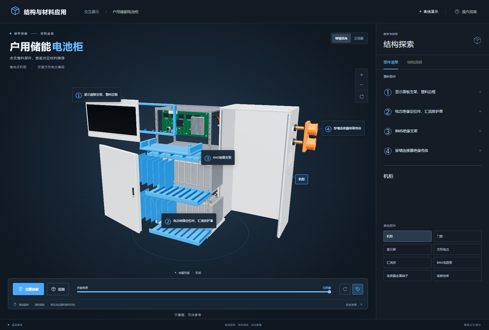

# 3D电池模型 · 结构与材料应用

## 第一次在新Windows电脑上使用

先安装 Git for Windows 和 Node.js 22或以上版本。使用有权访问此私有仓库的GitHub账号登录；克隆时如弹出登录窗口，按提示完成浏览器授权。

在PowerShell里进入你想存放项目的目录，依次执行：

```powershell
git clone https://github.com/ydf-1/battery-3d-demo.git
cd battery-3d-demo
npm install
npm run build
```

开发依赖版本由 `package-lock.json` 锁定，安装时不要省略开发依赖。两台电脑都将各自克隆出的整个 `battery-3d-demo` 文件夹作为工作目录。每次先阅读 [需求](docs/需求.md)，再 `git pull --ff-only`；修改后按 [协作规则](AGENTS.md) 构建、更新离线文件、提交并推送。

只演示时，直接双击 `release/两轮车电池包-离线.html`，不用安装Node.js。开发安装和Git同步需要联网；HTML运行完全离线。若克隆连接超时，检查该电脑访问GitHub的网络及本机代理配置；不要把其他电脑的代理地址直接照抄。

`v1.1` 标签保留原始源码压缩包的完整内容，首次提交没有改目录结构或文件内容。

## 户用储能电池柜（P3）

双击 [户用储能电池柜-离线.html](release/户用储能电池柜-离线.html) 即可打开新页面，无需安装开发环境或联网。白色钣金机柜、独立前门板、黑色玻璃显示屏、上层 BMS 和下方两层方形电芯均由几何代码生成。

页面默认打开外部壳件，便于观察内部结构。「完整拆解」先移开外壳、门板和显示屏，再展开内部组件；「组装」反向归位。点击塑料编号可单独展开，再点同一编号归位。封闭状态选择内部塑料件时会先打开外部壳件。

| 编号 | 塑料部件 | 邦泰推荐 |
| --- | --- | --- |
| ① | 显示面板支架、塑料边框 | BT-CS 阻燃系列（PC/ABS）、BT-PC 阻燃系列 |
| ② | 电芯绝缘定位件、汇流排护罩 | BT-PA66 阻燃增强系列 |
| ③ | BMS绝缘支架 | BT-PA66 阻燃增强系列 |
| ④ | 穿墙连接器绝缘壳体 | BT-PA66 阻燃增强系列，可按需求配色 |

①—③为蓝色，④为橙色。两个穿墙连接器随外壳整体移动，单独拆出橙色壳体时金属端子留在原位。机柜、门板、显示屏、电芯、汇流排、BMS 电路板、金属端子和线束不编号，点击只显示名称，不改色、不单独拆出。页面不显示整包电压、容量或串并联参数。



新文件与原有框架的关系：

- `models/home-storage/model.js`：白色外壳、门板、显示组件、BMS、两层方形电芯及四组塑料件。
- `models/home-storage/data.js`：编号、名称和推荐原文，不含整包参数。
- `models/home-storage/app.js`：复用原页面的 Three.js、OrbitControls、OutlinePass、拾取及控制方式，增加先开外壳再展开内部的阶段动画。
- `models/home-storage/index.template.html`、`style.css`：储能柜界面与手机布局；构建时合并原有 `dist/style.css`。
- `models/home-storage/index.html`、`release/户用储能电池柜-离线.html`：内容一致的单文件成品。
- `tests/home-storage.mjs`：浏览器交互验收；结果见 `docs/储能柜验收.json`，截图均在 `docs/screenshots/`。

`npm run build` 同时构建原两轮车和新储能柜页面，并更新储能柜离线成品。内容相同的文件不会重写；若已有未提交的 `dist/index.html` 与新构建不同，会停止覆盖，保留用户改动。

浏览器测试需要可用的 Playwright 测试运行时和 Chrome；它们不是成品依赖。已有独立测试运行时可通过 `PLAYWRIGHT_MODULE_PATH` 指定 Playwright 模块路径，`CHROME_EXECUTABLE_PATH` 指定 Chrome 路径，再运行 `node tests/home-storage.mjs`。测试在浏览器离线模式下用 `file://` 打开成品，检查文案、分阶段动画、重复点击归位、非塑料材质、实际画布拾取、旋转缩放与手机宽度布局。

手机检查是浏览器视口模拟，未在真实手机或另一台实体电脑上运行。新增储能柜不表示原电动工具模型和 v1.2 整体验收已完成，本轮不新增版本标签。

## 两轮车离线页面

双击 `dist/index.html` 即可运行。Three.js、页面样式、脚本和图标全部内联；几何体由代码生成，不使用外部模型、图片、字体或网络接口。页面包含禁止联网的内容安全策略，浏览器运行时不需要安装或联网。

## 部件与交互

| 编号 | 部件表名称（原文） | 邦泰推荐（原文） | 当前模型对应 |
|---|---|---|---|
| ① | 上盖、底座、塑料外壳 | BT-CS 阻燃系列（PC/ABS），户外件加耐候 | 哑光黑提手上盖与底座，联动拆出、归位 |
| ② | 电芯支架、铝壳内绝缘支架 | BT-PC 阻燃、增强系列 | 电芯组上、下两块蓝色支架，联动拆出、归位 |
| ③ | BMS支架 | BT-PA66 阻燃增强系列 | 独立蓝色塑料托架，承托上方电路板 |
| ④ | 放电口、换电连接器座 | BT-PA66 阻燃增强系列 | 底座前方蓝色塑料插座，内部为金属插片 |

①沿用用户部件表的完整名称；当前外部方筒按用户后续要求采用铝型材，独立显示为“铝型材外壳”，不属于①的塑料几何体。

点击①到④，只在信息面板显示编号、名称和“邦泰推荐”原文。点击铝型材外壳、电芯组、BMS电路板、汇流排、金属插片或金属紧固件，只显示名称，不拆出、不改色、不添加编号。

页面保留完整拆解/组装动画、拆解滑块、自由旋转缩放、自动旋转、编号标注开关、单独拆出再点击归位、桌面与手机布局。底座移动时插座随底座移动；插座同时支持独立拆出。

整包仅显示“示意配置”中的 13S5P、48.1V、25Ah。几何体按用户指定的 65 颗圆柱电芯绘制，单体直径 21 mm、长度 70 mm。电芯竖直排列，模型上没有文字、品牌、商标或型号。

模型下方显示：示意图，仅供参考。

## 操作

- 拖动旋转，滚轮缩放，右键拖动平移。
- 触屏单指旋转，双指缩放或平移。
- 点击模型、编号标注或部件清单选择部件。
- 聚焦模型区域后，方向键旋转，+ / − 缩放，空格拆解/组装，R 重置视角，L 切换标注。

## 源码分工

- `dist/model.js`：几何体、材质和可独立移动的部件组；保留金属插片与塑料座的独立拾取身份。
- `dist/data.js`：用户批准的编号、名称、推荐原文及整包示意配置。
- `dist/app.js`：部件联动、鼠标拾取、视角控制、动画、塑料高亮及界面渲染。
- `dist/index.template.html`：页面结构、网络禁用策略和“示意图，仅供参考”。
- `dist/style.css`：深色蓝色界面、标注、桌面及手机布局。
- `build.mjs`：打包为自包含 `dist/index.html`。
- `offline-check.mjs`：在打包时检查网络禁用策略与外部资源引用。

修改源文件后，需要在开发电脑安装 Node.js 与构建依赖：运行 `npm install`，再运行 `npm run build`。开发环境安装依赖可能需要网络；生成的 HTML 在浏览器中运行完全离线。Three.js MIT 许可证见 `THREE-LICENSE.txt`，也已内嵌在 HTML 中。

## 验证范围

已在 Chrome 无头浏览器中检查离线加载、批准文案、示意配置、联动拆解、金属材质保持、单件归位、控制面板和手机宽度布局。已通过实际画布点击分别命中金属插片与蓝色插座，验证两者的显示和高亮行为不同。运行测试中外部网络请求及浏览器脚本错误均为零。未在真实手机设备上测试。
